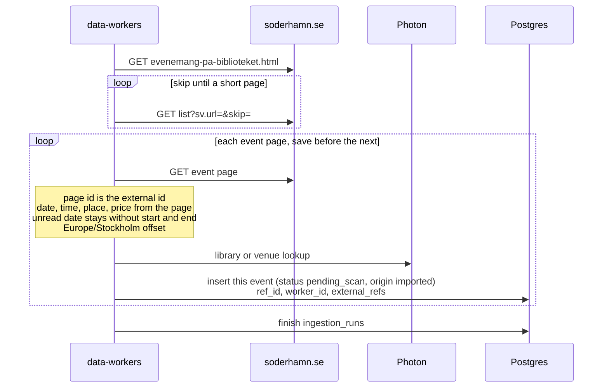

# Söderhamns stadsbibliotek import

The public calendar on soderhamn.se is the `soderhamn-biblioteket` source. There is no API. The
worker reads the Sitevision HTML the calendar page already serves.

The `data_sources` row is seeded disabled, trust `review`, schedule every 6 hours. A manual run
still fetches and saves. Saved events are `pending_scan` with `origin = imported`. The scan job
moves them to `in_review` or `published`. Flow: [event-scan.md](./event-scan.md).

`robots.txt` allows the calendar and disallows `jsessionid` URLs. The first page is the clean list
path. Later pages are that path with `sv.url` set to the portlet id and `skip` set to the page
offset. The worker does not request a session id.

Each list item is one event page. That page is saved before the next page is fetched. The
Sitevision page id is the external id, so two showings of the same title on the same day stay
separate. Date, time, place, and price come from the event page. A date that cannot be read is
still saved, with empty start and end. Times use the Europe/Stockholm offset. A date with no clock
is a whole day.

The organizer key is the library desk email, `biblioteket@soderhamn.se`. The chief's address on the
same contact card is not used. An `Arrangör` line in the text is the organizer name. Otherwise the
name is Söderhamns stadsbibliotek.

The place street, postcode, and city are stored on `meta.address`. The import does not geocode. The scan geocodes a missing point later. The seeded row
stays disabled until a manual run succeeds.

