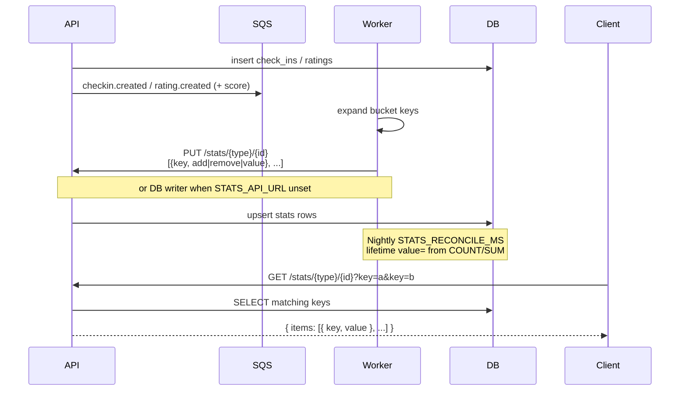

# Stats counters

Single EAV table `stats` (`source_type`, `source_id`, `key`, `value`). The worker expands
lifetime + day/week/month/year keys and `PUT`s mutations; the API applies the body as-is
(no further key expansion). Averages use `numRatings` + `totalRatingValue` (client divides).
`remove` does not clamp below zero. `PUT` requires `STATS_WORKER_TOKEN` (Bearer or
`X-Stats-Worker-Token`). Nightly reconcile resets **lifetime** keys via `value` from source
tables.

Key examples: `numCheckins`, `numCheckins-2026-01-07`, `numCheckins-w02`,
`numCheckins-2026-m01`, `numCheckins-2026`.

