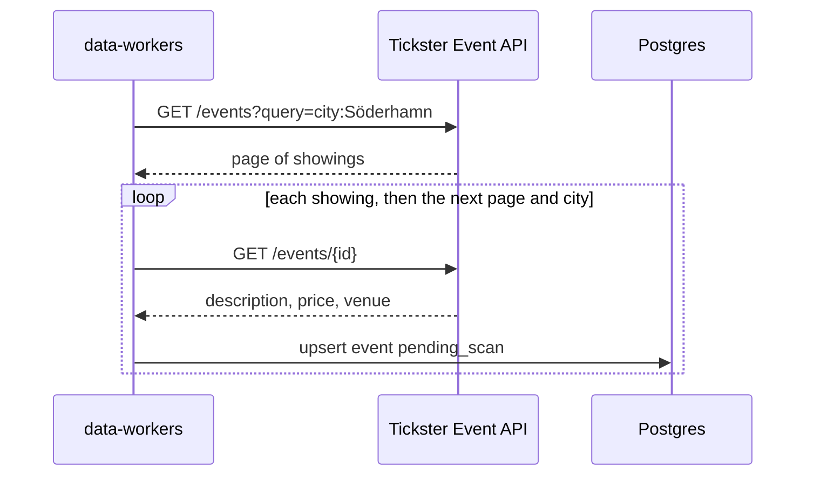

# Tickster import

Tickster is the `tickster` source. The worker calls Event API v1.0. The key is `TICKSTER_API_KEY`.
It is not stored in `data_sources.config`.

The `data_sources` row is seeded disabled, trust `review`, schedule every 6 hours. A manual run
still fetches and saves. Saved events are `pending_scan` with `origin = imported`. The scan job
moves them to `in_review` or `published`. Flow: [event-scan.md](./event-scan.md).

For each configured city (Söderhamn, Bollnäs, Hudiksvall, Ljusdal) the worker calls
`GET https://event.api.tickster.com/api/v1.0/sv/events?query=city:{city}`. The key goes in the
`x-api-key` header. A redirect off `event.api.tickster.com` fails that request. Each response
includes `X-RATELIMIT-REMAINING`. When that is 0, the next request waits five minutes, which is
one rate-limit slot. A 429 is retried the same way, for up to an hour. Each showing is fetched
and saved before the next one.

A production or collection is the parent of its nights. The parent is not saved. Each child whose
venue city is one of the configured cities is saved as its own event. A cancelled showing is
skipped. A UTC time is that instant. A showing with no clock is still saved, with empty start and
end.

The shop URL is a ticket link. The Tickster event page is an info link. The organizer email, then
the organizer website, identifies the organizer. Ticket price is the cheapest ticket in minor
units. A zero ticket price is free. The venue street, postcode, city, and point are stored when
the API sends them. A point of 0, 0 is omitted. The import does not geocode.

