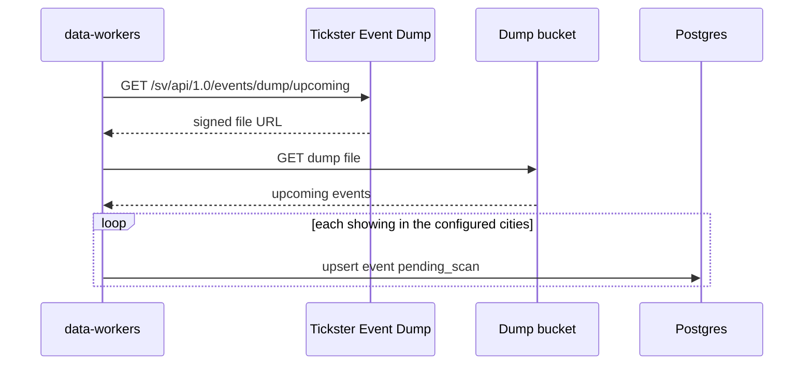

# Tickster import

Tickster is the `tickster` source. The worker calls the Event Dump at
`GET https://api.tickster.com/sv/api/1.0/events/dump/upcoming`. The key is `TICKSTER_API_KEY`.
It is not stored in `data_sources.config`. The path version is `1.0`. The file still uses the
older event names (`start`, `goods`, `infoUri`), not the Event API field names.

The `data_sources` row is seeded disabled, trust `review`, schedule every 6 hours. A manual run
still fetches and saves. The dump itself is published about once a day. Saved events are
`pending_scan` with `origin = imported`. The scan job moves them to `in_review` or `published`.
Flow: [event-scan.md](./event-scan.md).

The pointer returns a dump id and a signed file URL. The file is gzip JSON on the
`event-api-dumps` S3 bucket. The worker downloads that URL as given and does not log it. A
redirect off `api.tickster.com`, or off that bucket, fails that request. The test ingest script
sets `TICKSTER_STOP_ON_403`, so a 403 from the pointer stops this source and the script continues.

The file lists every upcoming event. A showing is kept when its venue city is Söderhamn, Bollnäs,
Hudiksvall, or Ljusdal. An empty city is left out. A production or collection is the parent of its
nights. The parent is not saved. Each child whose venue city matches is saved as its own event,
once, even when that showing is also a top-level row. A cancelled or unpublished showing is
skipped. A time with an offset is that instant. A showing with no clock is still saved, with empty
start and end.

The shop URL is a ticket link. The Tickster event page is an info link. Organizer Facebook and
Instagram come from the dump. The dump has no organizer email or website. Ticket price is the
cheapest ticket in minor units. A zero ticket price is free. A season offer is not a ticket price.
The venue street, postcode, city, and point are stored when the file sends them. A point of 0, 0
is omitted. The import does not geocode.

