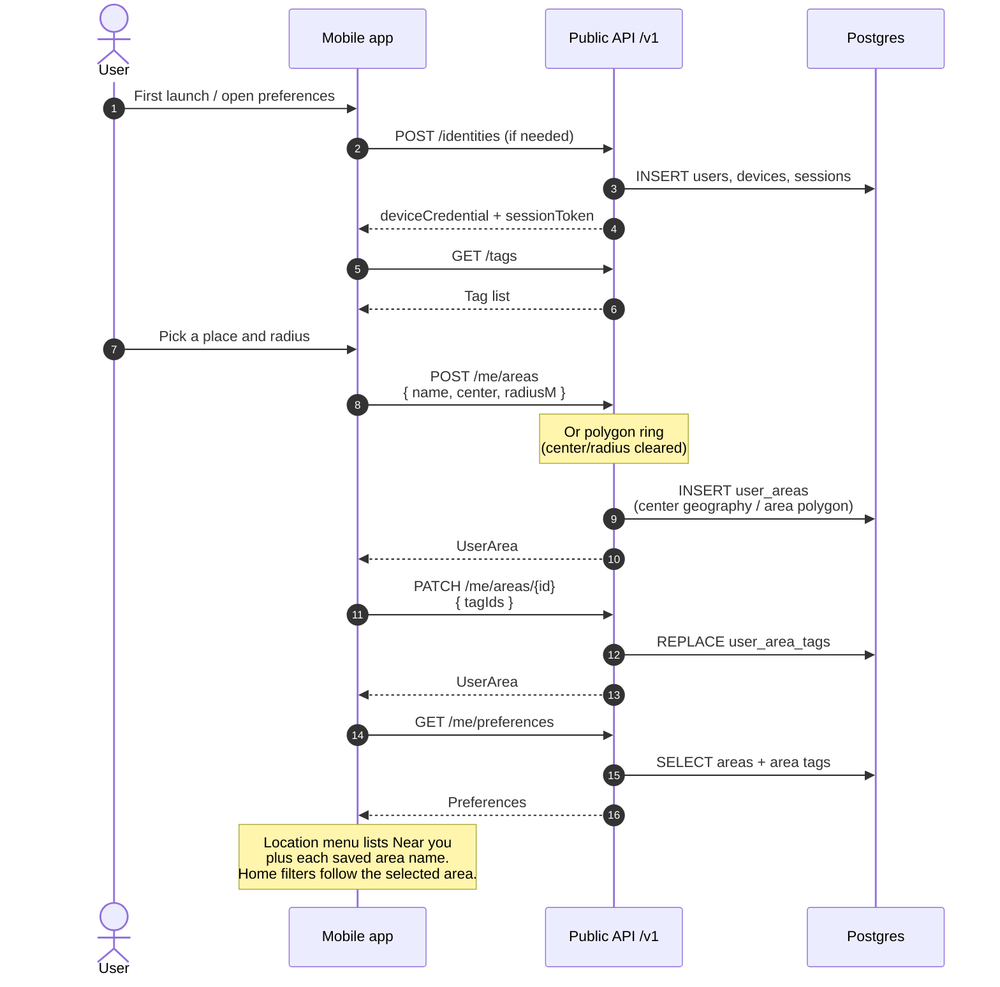

# Saved areas

App users (device credential → session token) persist notification and search areas, each with
its own tags. Mobile sends `Authorization: Bearer <sessionToken>`; web pairing can use the
app-user cookie.

## Sequence

## Notes

- No background location. While the app is open, “Near you” follows foreground location updates
  (a sample when the app becomes active, then about every 100 m). Areas are saved places only.
- “How far can you go” is a slider with stops at 1 km and then every 5 km through 100 km.
  It is stored on the user in meters (`travel_distance_m`, default 25 km) and decides when a
  place is far enough to suggest saving. `PUT /me/travel-distance`. Continuing the onboarding
  area step sets it to the chosen radius (5, 25, 50, or 100 km). Skipping leaves the default.
- The onboarding tags step stores that selection as the home chips on the device and, when the
  area step saved a place, on that area. Skip sends an empty list. There is no account-wide
  interest list. Nearby notifications use the tags on the covering area.
- Home chips follow the saved area that is selected. “Near you” uses the device chips. Editing
  chips while a saved area is selected replaces that area’s `user_area_tags`.
- The search-radius slider belongs to the place selected in the menu. Confirming it stores that
  radius on the device and on the user: `search_radius_m` on a saved area, `discovery_radius_m`
  for “Near you”. A new circle copies its notification radius into `search_radius_m`. Switching
  back restores the saved radius.
- The location menu plus button geocodes a place, posts a 25 km circle, then asks for the
  onboarding category groups. Saving a suggested region does the same after the area is created.
- Circle = `center` + `radius_m`; drawn polygon = `area` geography.
- Region kind (`regions` table + suggestion UI) is a later Phase 3 slice.
- Soft cap: 20 areas (`MAX_SAVED_AREAS` in domain).
