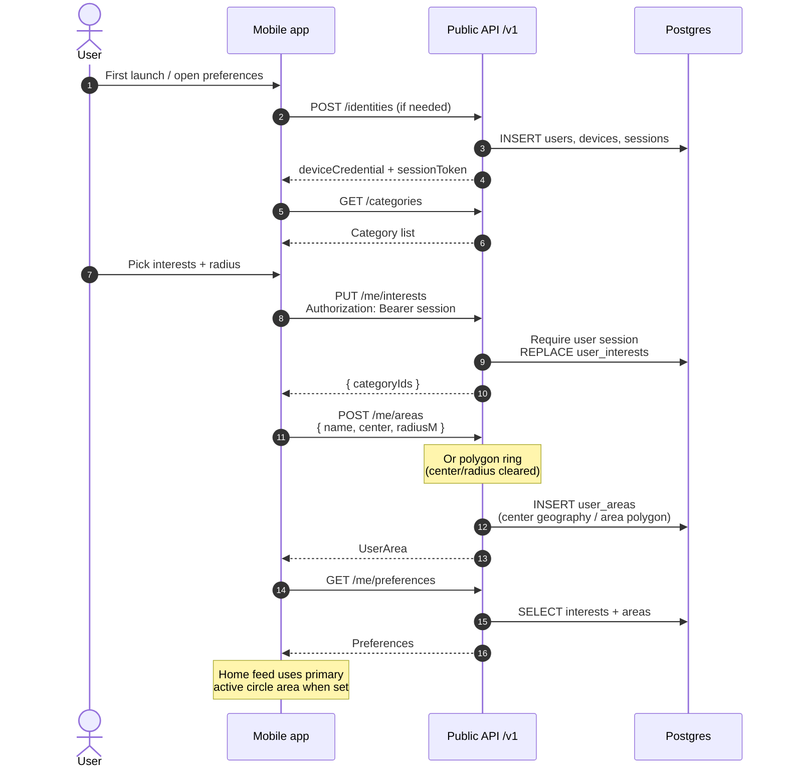

# User interests & saved areas

App users (device credential → session token) persist interest categories and notification/search
areas. Mobile sends `Authorization: Bearer <sessionToken>`; web pairing can use the app-user cookie.

## Sequence

## Notes

- No background location; areas are saved places only.
- Circle = `center` + `radius_m`; drawn polygon = `area` geography.
- Region kind (`regions` table + suggestion UI) is a later Phase 3 slice.
- Soft cap: 20 areas (`MAX_SAVED_AREAS` in domain).
