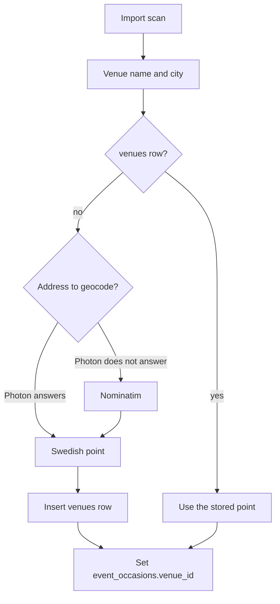

# Venue locations

A showing takes its point from a stored venue when that name and city already exist. A miss is geocoded, then stored, so the next showing at the same place does not ask again.

Photon is `https://photon.komoot.io/api/`. Nominatim is `https://nominatim.openstreetmap.org/search`, one request per second, with a User-Agent, and `countrycodes=se`. An empty Photon result is a miss and does not call Nominatim. OpenCage, Geoapify, LocationIQ, and Mapbox can replace either lookup when a key is configured. None of those keys is read yet.

A name that is only the city is not a venue. The first rows are copied from occasions that already have a name, a city, and a point. Showings at that name and city are linked, including ones that still have no point.

`--job venue-backfill` fills a showing that still has no venue, and a showing that has a name but no point. The scan's venue name is used, or the name already on the showing. When that name is only the city, the street is the venue name. A point already on the showing or the stored address is kept. Otherwise the address is geocoded. A showing that has a name and a point but no city gets the city from that point, and the venue is stored with the point. Photon is tried first. Nominatim is used when Photon does not answer.
