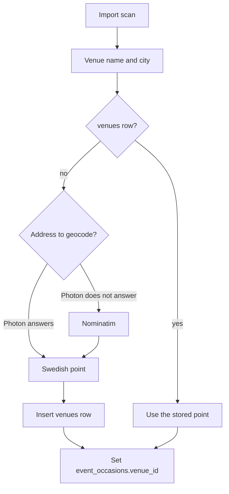

# Venue locations

A showing takes its point from a stored venue when that name and city already exist. A miss is geocoded, then stored, so the next showing at the same place does not ask again.

Photon is `https://photon.komoot.io/api/`. Nominatim is `https://nominatim.openstreetmap.org/search`, one request per second, with a User-Agent, and `countrycodes=se`. An empty Photon result is a miss and does not call Nominatim. OpenCage, Geoapify, LocationIQ, and Mapbox can replace either lookup when a key is configured. None of those keys is read yet.

The scan stores the street and postcode on the venue. A later scan fills a blank street and leaves a street that is already there. The point on an existing venue stays.

A name that is only the city is not a venue. The first rows are copied from occasions that already have a name, a city, and a point. Showings at that name and city are linked, including ones that still have no point.

`--job place-resolve` replays that order from the stored import and the stored scan output. It does not fetch a source and it does not call the model. An address the stored scan ranks over 80 replaces the scraped street, city, and point, and that address is geocoded. Otherwise a scraped point wins, then a point the scan printed, then the source building, then a street geocode, then the venue row, then Google Places for that name and city, then the town. A stronger rank replaces a weaker point on `venues`. Street hits are remembered in `known_addresses` and towns in `known_cities`. A miss is remembered so the next run does not ask again. `--live` is what calls Photon, Nominatim, and Places. Without it, only points already stored are used. `GOOGLE_PLACES_API_KEY` stays in the environment.

`--job rewind-scan` runs only against the local database on port 15432. Imported events that already have scan output go back to `pending_scan`, the summary and content verdict are cleared, and showing points are cleared except a point that was stored on the imported address. `llm_output` stays, so place-resolve can run again.

`--job venue-backfill` fills a showing that still has no venue, and a showing that has a name but no point. The scan's venue name is used, or the name already on the showing. When that name is only the city, the street is the venue name. A point already on the showing or the stored address is kept. Otherwise the address is geocoded. A showing that has a name and a point but no city gets the city from that point, and the venue is stored with the point. A town written in the place line is used before that. A source that covers one town, such as Visit Söderhamn or Bollnäs kommun, stores that town when the page names none. A source that covers many towns leaves the city empty. The best point is the street and its house number. The street name is next, and a rooftop Google returns on that street is kept when the result includes a house number. A stored town point does not skip a later lookup of a street address. The town is last. Google is tried first at each step, then Photon. A different house number is a miss. A place name and a number is kept when Google returns a precise point in that town. The name does not have to be a street. A close Google result is kept when the town matches and the place name and house number are nearly the same. The scan log lists each Google place. The city is then looked up with Google, then Photon. A city point is stored in `known_cities` and is not looked up again.
