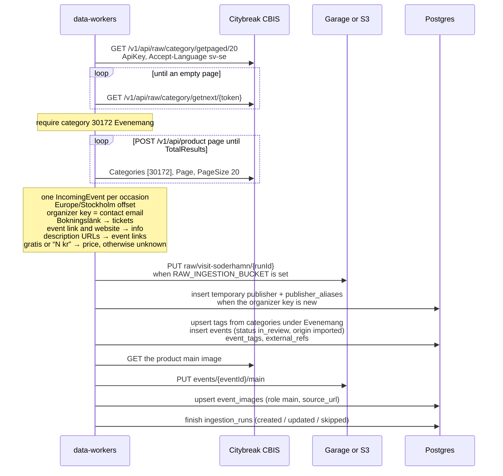

# Visit Söderhamn import

Citybreak CBIS is the first external source (`visit-soderhamn`). A manual run fetches, maps and
saves. The `data_sources` row is seeded disabled (no timer yet), trust `review`, schedule every
6 hours. The API key is `VISIT_SODERHAMN_API_KEY`.

Saved events are `in_review` with `origin = imported`. Each new contact email becomes a temporary
publisher (`publisher_aliases`). Unchanged content hashes are skipped. A close match to an event
already in the database links `external_refs` and does not overwrite that event. `in_review` rows
are not sent to the notification queue. When `RAW_INGESTION_BUCKET` is set, the raw fetch is
stored at `raw/<slug>/<runId>`. A main image is copied into the public assets bucket
(`events/<eventId>/main`) and linked in `event_images`. A failed image download does not fail the
event. Locally that bucket is Garage; in AWS it is S3 behind CloudFront.

Category paging uses a continue token that embeds the API key. The worker must not log that token.

