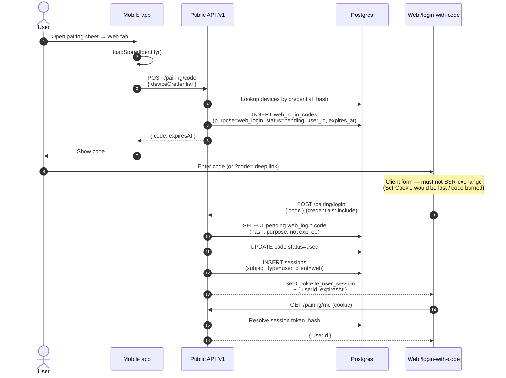

# Web sign-in with app pairing code

App user generates an 8-character code on the phone; the browser exchanges it for an httpOnly
session cookie. Codes are single-use, 5-minute TTL, purpose `web_login`.

## Sequence

## Need to know

- Exchange **only from the browser** (`credentials: 'include'`). Server-side `fetch` to the API
  consumes the code but never sets the user’s cookie.
- CORS must allow the web origin (`http://localhost:13100` in dev) with `credentials: true`.
- Reusing a code returns `401 invalid_pairing_code`.
