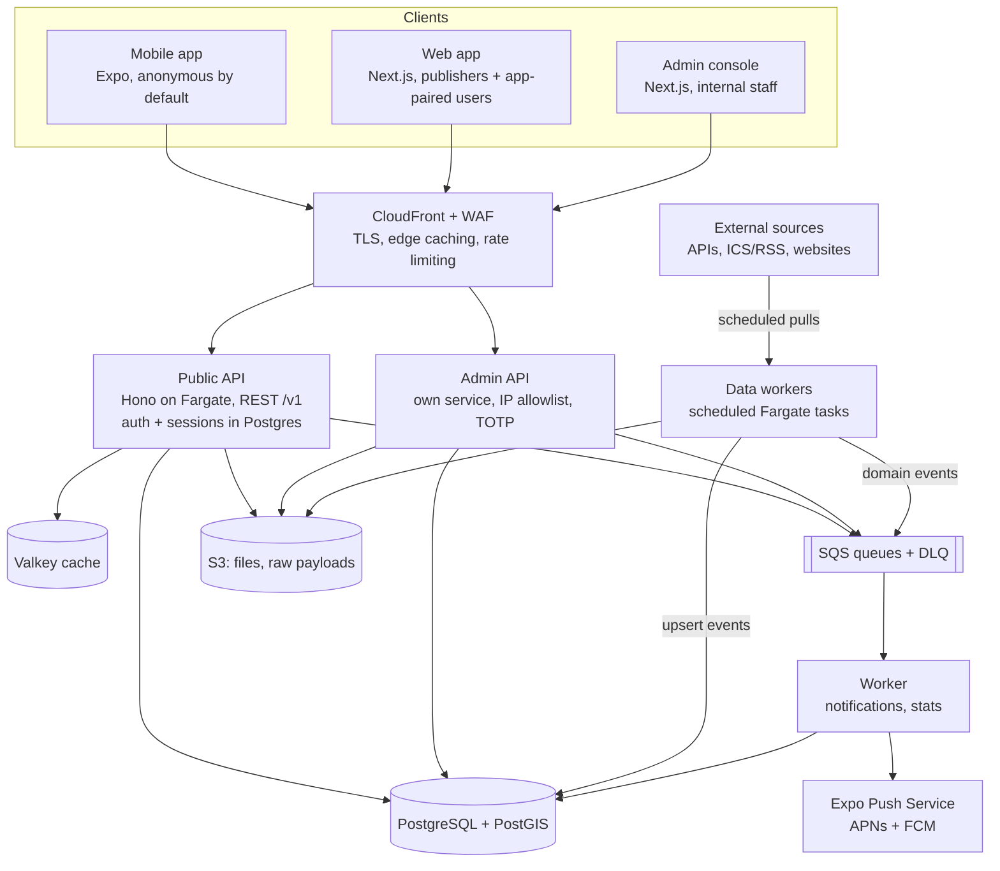

# Local Events — Project Description & Architecture

As of 2026-10-07. Source of truth for product scope and architecture. The phased build plan is in
[build-plan.md](build-plan.md); settled decisions are logged in [decisions.md](decisions.md).

## Project description

A cross-platform app (iOS, Android, web) that pushes people toward local and digital events they
actually care about, and proves who showed up. Users pick interest tags and a search area;
when a matching event is published inside that area, they get a notification.

Core concepts:

- **Publisher** — an organization or a person that owns events, with an email login for the web.
  Users can subscribe to a publisher and are notified when it publishes. Publishers for imported
  events are created automatically and can be claimed later by the real organizer.
- **Event** — physical (venue, optional point and geofence) or digital (online, with a live
  check-in code). A physical event without a point stays in the list, has no map pin, and does
  not match nearby push. Has tags, a schedule, and optional attendee-only content (maps,
  schedules, info). Users can subscribe to an event and are notified when it changes.
- **User** — anonymous by default: the app creates an identity on first launch, no registration.
  Sets interests, notification areas (radius around a point, a drawn area, or a region
  subscription offered when the app is used somewhere new), and subscriptions.
- **Profile** — offered at the user's first check-in. The user picks a display name or chooses to
  stay anonymous.
- **Check-in** — the proof of attendance. Physical events: the device's location is inside the
  event geofence during the event window. Digital events: the user enters or scans a code the
  publisher reveals when the event starts.
- **Rating** — only users who checked in can rate, and only after the event ends.
- **Stats** — aggregated per user, event and publisher: events attended, events rated, attendees
  per event, events published, average rating, and so on.
- **Data source** — an external API, feed or website that data workers pull events from on a
  schedule, so the catalog is not empty while publishers are few.

Check-in unlocks attendee content and is the input for both ratings and stats, so it is the
integrity anchor of the whole system.

## Scope

Three public frontends over two APIs. The mobile and web apps share the public API; the admin app
has its own. Data workers run beside them as a backend component with no frontend of their own.

| Frontend          | Audience                        | Purpose                                                                                                                                                                       | API    |
| ----------------- | ------------------------------- | ----------------------------------------------------------------------------------------------------------------------------------------------------------------------------- | ------ |
| Mobile app (Expo) | Attendees, publishers on the go | Discover, subscribe, check in, view attendee content, rate                                                                                                                    | Public |
| Web app (Next.js) | Attendees and publishers        | Same as mobile for users signed in through the app, plus the publisher workspace (email login): create/edit events, upload attendee content, reveal digital codes, view stats | Public |
| Admin (Next.js)   | Internal staff                  | Full CRUD on all data, data-source management, review of imported events, moderation, publisher verification, user bans, audit log                                            | Admin  |

**MVP (v1):** anonymous app identities, optional profiles, publisher accounts and profiles with
owner/editor members, web sign-in by app code, event CRUD with tags and location, discovery
feed and map, interest + area preferences, region subscriptions suggested in new places, push
notifications for new nearby events and subscriptions, physical and digital check-in, attendee
content, ratings, basic stats, admin CRUD and moderation, data workers for the first 2–3 sources,
Swedish and English UI, ads with consent, plan entitlements (all unlocked).
Launch area: Söderhamn and Gävleborgs län.

**Later:** paid publisher plans with Stripe Billing and featured placements, ticketing/payments,
recurring events, custom roles beyond owner/editor, social features (friends attending),
recommendations, in-app chat, analytics dashboards for publishers, more languages.

## Business model and publisher plans

The app is free for users and funded by ads at launch. In v1 all users and publishers publish for
free, and no subscription option exists anywhere in the product. Paid publisher plans are a future
feature; v1 only keeps the code ready for them.

**Ads:** banner and native ad slots in the feed and on event pages (mobile and web), never inside
the check-in or attendee-content screens. Non-personalized ads by default; personalized only after
consent through a GDPR consent dialog, plus Apple's tracking prompt on iOS.

**Future publisher plans** (not in v1; tiers, limits and prices decided when the feature is planned):

| Feature                           | Free            | Small              | Medium             | Large              |
| --------------------------------- | --------------- | ------------------ | ------------------ | ------------------ |
| Published events per month        | 2               | 10                 | 40                 | Unlimited          |
| Push to subscribers               | Yes             | Yes                | Yes                | Yes                |
| Push to nearby interested users   | No, listed only | Yes                | Yes                | Yes                |
| Ratings for the publisher         | Average only    | Average + comments | Average + comments | Average + comments |
| Featured events on the start page | 0               | 1 per month        | 3 per month        | 8 per month        |
| Members (owner + editors)         | 1               | 3                  | 10                 | Unlimited          |
| Stats                             | Basic counts    | Basic counts       | Detailed           | Detailed + export  |
| Ads on own event pages            | Shown           | Shown              | Hidden             | Hidden             |
| Price                             | Free            | TBD                | TBD                | TBD                |

How it is built:

- **Entitlements from day one:** every limit above is a plan field checked in `domain` (see
  `packages/domain/src/entitlements.ts`). In v1 every publisher resolves to a launch plan with
  everything unlocked, so turning on billing later is a data change, not a refactor.
- **Billing later:** Stripe Billing with its customer portal, sold on the web workspace only.
  Confirm current app-store guidelines before launch.
- **Featured events (v1):** admins set `events.featured`. Published featured events sort first
  on the home page. This is separate from the later paid placement record (slot, date range, plan
  quota), which labels promoted items.

Open tension for the future: "push to nearby users" is the core user value, so gating it hard could
make the free catalog feel empty. Imported events also matter here, since an organizer whose events
are imported for free has less reason to pay.

## Architecture overview

Three clients reach two stateless APIs through CloudFront; data workers pull external events on a
schedule into the same database and queue, and a worker handles notifications and stats.



Auth lives in the APIs themselves, with users, devices and sessions in Postgres; there is no
external identity provider. Imported events emit the same domain events as published ones, so
matching and notifications work identically.

## API decision: REST with an OpenAPI contract

REST for both APIs, defined in TypeScript with Zod schemas that generate an OpenAPI spec and typed
clients. GraphQL's main win, flexible client-shaped queries, matters less here than caching,
versioning and simple auth.

| Concern                                         | REST + OpenAPI                                              | GraphQL                                                      |
| ----------------------------------------------- | ----------------------------------------------------------- | ------------------------------------------------------------ |
| Old mobile builds in the wild                   | Explicit versions (`/v1`), easy to keep old endpoints alive | Schema evolution works, but deprecations are harder to track |
| Caching public event lists                      | HTTP + CloudFront caching per URL                           | Needs persisted queries or a GraphQL-aware cache             |
| Per-field authorization (attendee-only content) | Endpoint-level checks, easy to audit                        | Field-level resolvers, easy to leak by accident              |
| Geo and feed queries                            | Purpose-built endpoints, predictable SQL                    | Arbitrary nesting invites N+1 and expensive queries          |
| Type safety across monorepo                     | Generated client from OpenAPI                               | Generated client from schema                                 |
| Third parties later (publisher integrations)    | OpenAPI is the common default                               | Fine, but less common for integrators                        |

- **Public API** (`api.<domain>/v1`) — used by mobile and web. Identity, feed, map, events,
  publishers, subscriptions, check-ins, ratings, stats, uploads, web pairing.
- **Admin API** (`admin-api.<domain>/v1`) — separate service and deployment, separate admin
  accounts with TOTP MFA, network-restricted. Generic list/filter/sort/CRUD for every entity plus
  moderation actions and an audit log.
- Both APIs and the data workers import the same domain and database packages, so business rules
  are written once.

If screens later need heavily composed data, add a few aggregate endpoints (e.g. `GET /v1/home`)
before reaching for GraphQL.

## Tech stack

TypeScript end to end, so schemas, validation and API types are shared across every app.

| Layer                  | Choice                                                                                                       | Why                                                                     |
| ---------------------- | ------------------------------------------------------------------------------------------------------------ | ----------------------------------------------------------------------- |
| Language               | TypeScript                                                                                                   | One language across mobile, web, admin, APIs and infra                  |
| Monorepo               | pnpm workspaces + Turborepo                                                                                  | Fast installs, cached builds, task graph across apps                    |
| Mobile                 | Expo, Expo Router, EAS, `@expo/ui` + custom UI (Events Booking visual language)                              | Managed builds and store submission, OTA updates for JS fixes           |
| Mobile native features | expo-location, expo-task-manager, expo-notifications, expo-camera (QR), expo-secure-store, react-native-maps | Location check-in, push, code scanning, device credential storage, maps |
| Web app                | Next.js (App Router) + Material UI                                                                           | SEO for public event pages, publisher workspace                         |
| Admin                  | Next.js + Material UI + TanStack Table                                                                       | Fast data-heavy CRUD screens                                            |
| Client data            | TanStack Query + generated API client                                                                        | Caching, retries and offline-friendly reads on all three frontends      |
| API framework          | Hono + @hono/zod-openapi on Node.js                                                                          | Lightweight, Zod-first, emits OpenAPI                                   |
| ORM / migrations       | Drizzle ORM + drizzle-kit                                                                                    | Typed SQL, good PostGIS escape hatches                                  |
| Database               | PostgreSQL + PostGIS (Amazon RDS)                                                                            | Geo queries (radius, polygon, geofence) with GiST indexes               |
| Cache / rate limiting  | ElastiCache (Valkey)                                                                                         | Feed caching, rate limits, check-in throttling                          |
| Async jobs             | Amazon SQS (+ DLQ) and a worker service; ElasticMQ locally via Docker Compose                                | Notification fan-out, stats, media processing                           |
| Scheduling             | EventBridge Scheduler                                                                                        | Event start/end triggers, rating prompts, source runs                   |
| Data workers           | Node.js container per run on ECS Fargate, one adapter per source                                             | Small, scheduled, pay per run; same domain code as the APIs             |
| Fetching and parsing   | fetch for APIs, ical.js for ICS, a feed parser for RSS, Cheerio for HTML, Playwright only when unavoidable   | Cheapest tool per source; browser image kept separate                   |
| Push                   | Expo Push Service (APNs + FCM underneath)                                                                    | One API for iOS and Android, receipts for cleanup                       |
| Ads                    | Google AdMob (react-native-google-mobile-ads), Ad Manager or AdSense on web, Google UMP consent              | Works with Expo dev builds; consent handling built in                   |
| Billing (future)       | Stripe Billing + customer portal, webhooks handled by the worker                                             | Subscriptions and VAT invoices without our own billing UI               |
| Email                  | Amazon SES                                                                                                   | Verification, recovery codes, invites                                   |
| Auth                   | Own auth module (`packages/auth`): device credentials, publisher email + password, admin password + TOTP     | Anonymous users, no third-party identity provider                       |
| Files                  | S3 + CloudFront. Public heroes are unsigned CloudFront URLs; attendee files stay signed                     | Event images, maps, PDFs                                                |
| Search                 | Postgres full-text first; OpenSearch only if needed                                                          | Avoid an extra system in v1                                             |
| Infra as code          | AWS CDK (TypeScript)                                                                                         | Same language, lives in the monorepo                                    |
| CI/CD                  | GitHub Actions + EAS                                                                                         | Test, build images, deploy per environment                              |
| Observability          | CloudWatch + OpenTelemetry, Sentry for mobile/web errors                                                     | Traces across API and workers, crash reports                            |

Auth library option: Better Auth (anonymous, email/password, 2FA, sessions in Postgres) can carry
much of this. If used, wrap it in `packages/auth` so device credentials and the web
sign-in-by-app-code flow stay under our control.

## Monorepo layout

Seven deployables, shared packages for everything that must stay consistent. Rule: apps import
packages, packages never import apps.

```
/apps
  mobile/        Expo app (iOS + Android)
  web/           Next.js public web app + publisher workspace
  admin/         Next.js admin console (login + publisher verification)
  api/           Public REST API (Hono)
  admin-api/     Admin REST API (Hono; password + TOTP)
  worker/        SQS consumers + scheduled jobs
  data-workers/  Ingestion runner, one container image
    src/sources/   one adapter per source (fetch → map)
/packages
  contracts/     Zod schemas shared by APIs and clients
  auth/          Device credentials, sessions, pairing codes, publisher/admin login
  domain/        Business rules: check-in, ratings, publishing status, entitlements, regions
  ingest/        IncomingEvent shape, adapter interface, content hash, dedupe
  db/            Drizzle schema, migrations, PostGIS helpers
  geo/           Distance and geofence utilities (client and server)
  config/        Shared tsconfig presets
  api-client/    Generated typed client from public OpenAPI (`pnpm api-client:generate`)
  (later) admin-client/
/infra           AWS CDK app
```

## Data model

Core tables in PostgreSQL; geography columns use PostGIS with GiST indexes. `packages/db` contains a
starter subset; the rest is added phase by phase.

| Entity                      | Key fields                                                                                                                                                                                                                                            | Notes                                                                                                                                                               |
| --------------------------- | ----------------------------------------------------------------------------------------------------------------------------------------------------------------------------------------------------------------------------------------------------- | ------------------------------------------------------------------------------------------------------------------------------------------------------------------- |
| `users`                     | id, display_name (nullable), is_public (default false), recovery_email (nullable), recovery_email_verified_at, profile_chosen_at (nullable), timezone (default Europe/Stockholm), quiet_hours_start_min / end_min / enabled, created_at, last_seen_at | Created on first app launch; `profile_chosen_at` set after named/anonymous prompt; recovery email stored unverified until verify flow ships; quiet hours defer Expo |
| `devices`                   | id, user_id, credential_hash, expo_push_token, platform, locale, last_seen_at                                                                                                                                                                         | The app's identity credential; pruned on push receipt errors                                                                                                        |
| `sessions`                  | id, subject_type (user / publisher_account / admin), subject_id, token_hash, client (app / web / admin), expires_at, revoked_at                                                                                                                       | Opaque tokens, hashed at rest, revocable                                                                                                                            |
| `web_login_codes`           | id, code_hash, purpose (web_login / device_link), browser_label, status, user_id, device_id (device_link), expires_at                                                                                                                                 | 5-minute TTL, single use; device_id is the device remapped on confirm                                                                                               |
| `publisher_accounts`        | id, email, password_hash, email_verified_at                                                                                                                                                                                                           | Web login for publishers                                                                                                                                            |
| `email_verification_tokens` | id, purpose, subject_id, token_hash, expires_at, used_at                                                                                                                                                                                              | Publisher email verification (and later recovery emails); hashed, single-use                                                                                        |
| `admin_users`               | id, email, password_hash, totp_secret, role                                                                                                                                                                                                           | Separate table, never mixed with app users                                                                                                                          |
| `publishers`                | id, type (org / person), name, slug, verified, origin (native / imported), is_temporary, claimed_at                                                                                                                                                   | Imported publishers start temporary; an admin re-maps them or completes their details                                                                               |
| `publisher_aliases`         | source_id, external_organizer_key, publisher_id, mapped_by, mapped_at                                                                                                                                                                                 | Remembers which publisher a source's organizer maps to                                                                                                              |
| `publisher_members`         | publisher_id, publisher_account_id, role (owner / editor)                                                                                                                                                                                             | Owner: profile, members, deletion + editor rights. Editor: events, content, codes, stats                                                                            |
| `publisher_invites`         | id, publisher_id, email, role, token_hash, invited_by_account_id, expires_at, accepted_at                                                                                                                                                             | Owner-created email invites; hashed token, 7-day TTL; accept requires matching session email                                                                        |
| `plans`                     | id, slug, events_per_month, push_nearby, rating_comments, featured_per_month, max_members, stats_level, hide_ads, stripe_price_id                                                                                                                     | v1: one launch plan with everything unlocked                                                                                                                        |
| `publisher_subscriptions`   | publisher_id, plan_id, status, period_start, period_end, stripe_subscription_id                                                                                                                                                                       | Future feature; not created in v1                                                                                                                                   |
| `featured_placements`       | id, event_id, publisher_id, slot, area, starts_at, ends_at                                                                                                                                                                                            | Future feature                                                                                                                                                      |
| `tags`                      | id, slug, name, external_id                                                                                                                                                                                                                           | Flat vocabulary. Launch tags are Visit Söderhamn categories under Evenemang                                                                                         |
| `events`                    | id, publisher_id, title, description, mode, starts_at, ends_at, status (draft / awaiting_verification / in_review / published / cancelled / ended), origin, source_url, location, geofence or geofence_radius_m, venue_name, online_url, timezone, price_amount, currency, featured, check_in_enabled, attendee_text | Point drives discovery, geofence drives check-in. `price_amount` is minor units; null means unknown and is listed as free, 0 means free. Visit import fills a positive amount only from an explicit “N kr” in the description. `featured` is an admin pick shown first on the home page. `check_in_enabled` is an admin opt-in; `attendee_text` is publisher text shown only after check-in |
| `event_tags`                | event_id, tag_id                                                                                                                                                                                                                                      | Many-to-many                                                                                                                                                        |
| `event_links`               | id, event_id, type (tickets / registration / info), url, label, position                                                                                                                                              | Outbound actions. Not a ticket record                                                                                                                               |
| `saved_events`              | user_id, event_id, created_at                                                                                                                                                                                         | Bookmark. Cascade with the user. Distinct from `subscriptions`                                                                                                      |
| `event_lists`               | id, user_id, name, created_at                                                                                                                                                                                         | Up to 20 named lists per user. Cascade with the user                                                                                                                |
| `event_list_items`          | list_id, event_id, created_at                                                                                                                                                                                         | Up to 100 events per list                                                                                                                                           |
| `event_images`              | id, event_id, role (default main), s3_key, source_url, content_type                                                                                                                                                                                  | Public hero in the assets bucket. Key `events/{eventId}/main`. Local Garage, AWS CloudFront                                                                        |
| `event_content`             | id, event_id, kind (map / schedule / info / file), title, body, s3_key, visibility (public / attendees)                                                                                                                                               | Attendee-only content gated by check-in                                                                                                                             |
| `user_interests`            | user_id, tag_id                                                                                                                                                                                                                                       | Tags the user wants nearby notifications for                                                                                                                        |
| `user_areas`                | id, user_id, name, kind (manual / region), origin (manual / suggested), region_id, area, center, radius_m, notify, active                                                                                                                             | Circle, drawn polygon, or region subscription                                                                                                                       |
| `regions`                   | id, name, kind (municipality / county), code, boundary                                                                                                                                                                                                | Launch: simplified Söderhamn/Gävleborg fixtures; replace with open Swedish boundary data later                                                                      |
| `subscriptions`             | user_id, target_type (publisher / event), target_id, created_at                                                                                                                                                                                       | PK (user, target_type, target_id); publisher follows notify on publish                                                                                              |
| `check_ins`                 | id, user_id, event_id, method (geo / code), lat, lng, accuracy_m, device_flags, created_at                                                                                                                                                            | Unique on (user, event); geo check-in via `POST /v1/events/{id}/check-ins`                                                                                          |
| `ratings`                   | user_id, event_id, score 1–5, comment, created_at                                                                                                                                                                                                     | Requires a check-in; comment only from named profiles                                                                                                               |
| `digital_codes`             | event_id, secret, revealed_at, rotation_s                                                                                                                                                                                                             | Secret seeds rotating codes; never sent to attendees                                                                                                                |
| `notifications`             | id, user_id, event_id, reason (nearby / publisher / event), sent_at (inbox accept time), push_state (pending / sent / aggregated legacy), pushed_at (nullable), read_at (nullable)                                                                    | Inbox for every match + silent Expo delivery; unique (user, event, reason). Cap/quiet hours are client-side. Purged after 90 days                                   |
| `data_sources`              | id, slug, kind (api / feed / scraper), schedule, config, trust (auto_publish / review), enabled                                                                                                                                                       | One row per source; secrets referenced, not stored                                                                                                                  |
| `ingestion_runs`            | id, source_id, started_at, finished_at, status, fetched, created, updated, skipped, error                                                                                                                                                             | Run history shown in admin                                                                                                                                          |
| `external_refs`             | source_id, external_id, event_id, content_hash, last_seen_at                                                                                                                                                                                          | Unique on (source, external_id); unchanged hash = skip                                                                                                              |
| `stats`                     | source_type (user/event/publisher), source_id, key, value, created_at, updated_at                                                                                                                                                                     | EAV counters; worker puts lifetime + day/week/month/year keys; averages via numRatings + totalRatingValue                                                           |
| `audit_log`                 | actor, action, entity, before, after, at                                                                                                                                                                                                              | Every admin write and every source run's changes                                                                                                                    |

## Key flows

Every write that matters emits a domain event (`event.published`, `event.updated`,
`checkin.created`, `rating.created`) onto SQS; the worker handles notifications and stats.

### Identity and sign-in

1. First launch: the app calls `POST /v1/identities`. The server creates a user and a device and
   returns the user id plus a random 256-bit device credential.
2. The app keeps both in expo-secure-store (Keychain / Keystore) and trades the credential for
   short-lived session tokens. A user id alone never authenticates. After a session is ready the
   mobile app may call `PUT /v1/me/push-token` with the device credential and an Expo push token.

3. First check-in: the app offers a profile — a display name, or stay anonymous
   (`PUT /v1/me/profile`). Optional recovery email may be stored (verification later).
4. Publishers log in on the web with a verified email and password (httpOnly cookie session).
5. App users sign in on the web by pairing: the app generates an 8-character code (5 min TTL),
   the user types it on the web `/login-with-code` page, and the browser receives an httpOnly
   app-user session cookie from `POST /v1/pairing/login`.

Recovery in v1: **device linking** — the new phone calls `POST /v1/pairing/device-link/code`,
the old phone confirms with `POST /v1/pairing/device-link/confirm` (same 8-character codes as web
pairing); the new device is reassigned to the confirming user. Optional **recovery email**
(one-time code issues a fresh device credential) is later. The email is never shown publicly.
Any linked device can be revoked.

### New event near me

1. Publisher publishes. From an unverified publisher the event is stored as
   `awaiting_verification` and nothing is enqueued; otherwise the API enqueues `event.published`.
2. The worker finds matching users in one PostGIS query: active notify area covers the event
   point (`ST_Covers` on polygon/region, `ST_DWithin` on circle), interests overlap (empty
   interests → no nearby push). Events without a point are skipped here.
3. Dedupe against `notifications` only (unique user + event + reason). Publisher followers merge
   in with nearby (nearby wins when both match). Fan-out capped at 500 candidates per path.
4. Insert a `notifications` inbox row for every match (visible in the app notifications window via
   `GET /me/notifications`, including `unreadCount` for the badge).
5. Always send a **silent/data Expo push** to devices with tokens (no alert title/body; includes
   badge + payload). Mark `push_state = sent` on Expo accept. Inbox rows are kept even if push
   fails. Quiet hours and the 5/day OS-notification cap are enforced **on the client** (optional
   local OS notification); opening the app always shows the full retained inbox.
6. Worker purges inbox rows older than 90 days. Expo sends in batches of 100; clear tokens on
   `DeviceNotRegistered`. Receipt polling later.

Areas are saved places, not live tracking.

### Region subscriptions

When a user actively uses the app somewhere new, the app offers to save that place as a regularly
visited region. The check runs on the device; the location only leaves the phone if the user accepts.

1. On app foreground, if location permission is already granted, read one coarse location. Never
   ask for permission just for this.
2. "New" = more than ~25 km from every saved area; "active" = ≥ 60 s in foreground or a few
   screens opened. Tunable (`REGION_SUGGESTION` in `packages/domain/src/regions.ts`).
3. Name the place with on-device reverse geocoding and offer: Save and notify me · Save without
   notifications · Not now · Never ask for this place.
4. On save, create a region subscription: the municipality boundary when known, else a 15 km circle.
5. At most one prompt per day, never during check-in, declined places not asked again for 90 days,
   "never" is permanent. Dismissals are stored on the device only.

### Subscriptions

- `POST/GET/DELETE /v1/me/subscriptions` — follow a publisher or a published event.
- Publisher subscription: notified on `event.published` from that publisher (merged with nearby;
  nearby reason wins if both match).
- Event subscription: stored now; notified on meaningful `event.updated` changes (time, venue,
  cancellation, new attendee content), debounced 10 minutes — handler still TODO.

### Physical check-in

Check-in is off for an event until an admin sets `check_in_enabled`. The publisher can then add
`attendee_text` and attendee-only links. Those are omitted from the public event and returned on
`GET /v1/events/{id}/content` only after a check-in.

1. Opens 30 minutes before `starts_at`, closes at `ends_at` (configurable per event).
2. The app reads a fresh high-accuracy foreground location.
3. The API validates: window, accuracy ≤ 100 m, within geofence + accuracy allowance, rate limit,
   no existing check-in (`validateGeoCheckIn` in `packages/domain`).
4. Device flags (Android mock location; App Attest / Play Integrity in v2) are stored for review.
5. Fallback indoors: a venue QR the publisher prints, using the digital-code mechanism.

### Digital check-in

The publisher presses Start; the screen shows a QR and a 6-character code derived from the event
secret and the current 60-second slot (TOTP-style). The server accepts current and previous slot.

### Attendee content

Attendee-only files sit in a private S3 prefix; the API returns short-lived CloudFront signed URLs
only to users with a check-in. The app caches content for offline use at the venue.

### Ratings

Once per event, check-in required, from `ends_at` until 14 days after. Publicly only the aggregate
(average + count) is shown. Comments are allowed only for named profiles and are visible to the
publisher and admins, never to the public. Anonymous users can still give a score.

### Stats

The worker increments counters per domain event; a nightly job recomputes from source tables.
Stats endpoints read the EAV `stats` table (`GET /stats/{sourceType}/{sourceId}?key=`).
`PUT` is worker-token only and applies body mutations without expanding keys.

### Data ingestion

1. EventBridge Scheduler starts one Fargate task per source on its cron, passing the source slug.
2. The adapter fetches and maps items to `IncomingEvent`. Raw payloads are not written to S3 yet.
3. `ingest` validates, geocodes, upserts source tags, copies http(s) links from the description onto the event, and resolves the publisher via `publisher_aliases`.
   A first-seen organizer gets a temporary publisher, and its events wait in review.
4. Dedupe: exact via `external_refs`; cross-source when start time, distance (~200 m) and title
   similarity all agree.
5. Upsert: trusted sources → `published`, others → `in_review`; unchanged hash → skip.
   A later run does not change `cancelled` or `ended`, and does not overwrite a cross-source match.
6. `event.published` / `event.updated` go to SQS only when the saved status is `published`.
   The run is logged in `ingestion_runs`. Raw payloads to S3 are not written yet.

Native data wins over imported data. Prefer official APIs and ICS/RSS feeds; scrape only where a
site's terms allow it, respect robots.txt and rate limits, and link back to the source.

## AWS infrastructure

ECS Fargate for backend services and data workers, managed data services, three AWS accounts
(dev, staging, prod) in **eu-north-1 (Stockholm)** under AWS Organizations, all defined in CDK
(`infra/`). Phase 1 ships three stacks — `network`, `data`, `services` — deployed to **dev** from
GitHub Actions (OIDC). CloudFront/WAF (`EdgeStack`) and scheduled data workers come later; ALBs are
HTTP-only until the edge stack adds HTTPS.

| Component         | AWS service                                                              | Notes                                                             |
| ----------------- | ------------------------------------------------------------------------ | ----------------------------------------------------------------- |
| Network           | VPC, 2–3 AZs, private subnets, NAT                                       | Fixed egress IP for data workers; shared App SG for ECS tasks     |
| Public API        | ECS Fargate behind ALB, CloudFront + WAF                                 | Autoscale on CPU/requests; cache public GETs                      |
| Admin API         | ECS Fargate behind its own ALB, WAF IP allowlist                         | Separate service and security group                               |
| Worker            | ECS Fargate service consuming SQS                                        | Scales on queue depth                                             |
| Data workers      | ECS Fargate scheduled tasks (~0.25 vCPU / 0.5 GB), EventBridge Scheduler | One task per source run; larger Playwright image only when needed |
| Web app and admin | Next.js on ECS Fargate or AWS Amplify Hosting                            | Amplify is less to run; Fargate keeps one pattern                 |
| Database          | RDS for PostgreSQL with PostGIS, Multi-AZ in prod                        | Holds users, sessions, credentials; PITR backups                  |
| Cache             | ElastiCache (Valkey)                                                     | Rate limits (login, pairing, check-in), feed cache                |
| Queues            | SQS standard + DLQs                                                      | One queue per consumer type                                       |
| Schedules         | EventBridge Scheduler                                                    | Event start/end, rating prompts, source runs                      |
| Files             | S3 public assets behind CloudFront (OAC), private files, raw-ingestion   | Heroes are public CloudFront URLs. Raw payloads expire after 30 days |
| Secrets           | Secrets Manager / SSM Parameter Store                                    | Session keys, source API keys, Expo token, DB credentials         |
| Email             | SES                                                                      | Verification, recovery codes, invites                             |
| Monitoring        | CloudWatch, X-Ray or OTel collector                                      | Alarms on 5xx, queue age, DB CPU, failed source runs              |

Mobile builds and store submissions run on EAS; EAS Update channels map to the three environments.

## Security, privacy and anti-abuse

- **Location minimization:** no background tracking in v1. Store saved areas (`user_areas`) and the
  single location sample at check-in; both are included in user export/deletion. Saved events and
  custom lists are personal and cascade when the user is deleted. Region suggestions
  compare locations on the device and send nothing unless the user saves the region. Round or drop
  raw check-in coordinates after ~90 days.
- **Permissions:** "While Using" location only, at first check-in or area setup. Notifications
  permission asked after interests are chosen.
- **Anonymous identity:** device credentials are random, in secure storage, hashed server-side and
  revocable. Export and deletion apply to anonymous users too.
- **Own auth:** Argon2id passwords, rate-limited login and pairing endpoints, single-use pairing
  codes with 5-minute TTL and in-app confirmation, httpOnly + Secure + SameSite cookies.
- **GDPR / store rules:** export and deletion endpoints from day one; privacy labels and Data Safety
  forms. Ad SDKs must appear in privacy labels; personalized ads need consent.
- **Authorization:** publisher-scoped writes checked in `domain`; attendee content via signed URLs;
  admin API behind an IP allowlist with TOTP MFA.
- **Check-in fraud:** geofence + accuracy rules, rate limits, device flags, admin review queue;
  identities with no history are weighted or flagged in stats and ratings.
- **Ratings:** check-in required, one per event, aggregates only in public, publishers cannot rate
  their own events.
- **Unverified publishers:** anyone can register, but their events are `awaiting_verification`
  (not listed, searchable or pushed) until an admin verifies them; then upcoming events are released.
- **Data sources:** check terms before enabling, prefer official APIs/feeds, identify the crawler
  with a contact address, per-source rate limits, attribution and link on every imported event.
- **Audit:** every admin write and every source run's changes logged.

## Risks and open questions

| Risk                                             | Impact                                           | Mitigation                                                              |
| ------------------------------------------------ | ------------------------------------------------ | ----------------------------------------------------------------------- |
| Too few events per area at launch                | Users get no notifications and churn             | Data workers for local sources; launch area by area; seed publishers    |
| Sources change format, block, or forbid scraping | Imported events stop or go stale; legal exposure | Prefer APIs/feeds, alarm on zero-item runs, check terms, small adapters |
| Duplicate or wrong imported events               | Duplicate notifications, lost trust              | Cross-source dedupe, review queue, native data wins                     |
| Anonymous identity lost on new phone             | User loses history and subscriptions             | Keychain sync; device linking and optional recovery email in v1         |
| Cheap anonymous identities                       | Fake check-ins and ratings                       | Rate limits, device flags, weighting identities with no history         |
| Indoor GPS too inaccurate                        | Real attendees fail check-in                     | Generous accuracy allowance, venue QR fallback                          |
| Notification fatigue                             | Users disable push                               | Daily cap, quiet hours, per-category mute                               |
| App store review of location use                 | Rejection or delays                              | Foreground-only location, clear purpose strings                         |
| Code sharing for digital events                  | Inflated attendance stats                        | Rotating codes, flag outliers; accept some leakage                      |

Open questions:

- [x] First data source: Visit Söderhamn, official Citybreak CBIS API. Events only (category
      Evenemang). Further sources in Gävleborgs län are still open.
- [ ] Investigate: someone registers as publisher A when an imported publisher A already exists.
      How do we detect the match (name, domain, email, org number), prove they are the real
      organizer, and merge or transfer the imported publisher and its events without letting an
      impostor take over?
